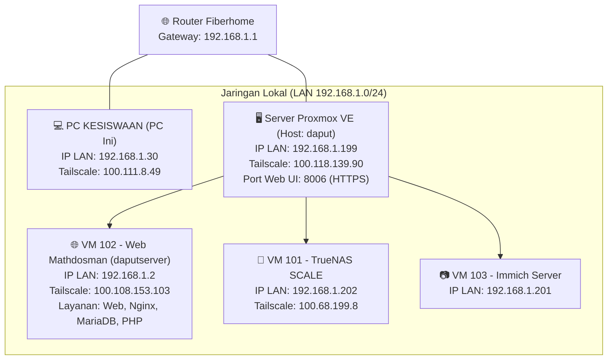

# 🖥️ Panduan Lengkap Akses Server Web Mathdosman & Proxmox

Dokumen ini berisi catatan teknis lengkap mengenai topologi jaringan, cara mengakses server dari komputer ini (**jalur lokal / LAN**), serta cara mengakses dari komputer lain di luar jaringan (**jalur remote / Tailscale**).

---

## 1. Peta Topologi & Alamat IP Jaringan



### Tabel Rangkuman Alamat IP & Port

| Perangkat / Layanan | IP Lokal (LAN) | IP Tailscale (VPN Remote) | Port & Protokol | Keterangan & Kredensial |
| :--- | :--- | :--- | :--- | :--- |
| **PC Kesiswaan (Komputer Ini)** | `192.168.1.30` | `100.111.8.49` | - | Windows 10/11, tempat koding & SSH Key disimpan |
| **Server Web Mathdosman (VM 102)** | `192.168.1.2` | `100.108.153.103` | Port 22 (SSH)<br/>Port 80/443 (HTTP/S) | User SSH: `daput`<br/>Auth: SSH Key `id_ed25519` |
| **Proxmox VE Host** | `192.168.1.199` | `100.118.139.90` | Port 8006 (Web UI)<br/>Port 22 (SSH) | User: `root`<br/>Auth: SSH Key & Password Web |
| **TrueNAS SCALE (VM 101)** | `192.168.1.202` | `100.68.199.8` | Port 80/443 (Web UI)<br/>Port 445 (SMB) | Penyimpanan File / Backup |
| **Immich Server (VM 103)** | `192.168.1.201` | - | Port 2283 (Web/App) | Server Backup Foto & Media |

---

## 2. Akses Server dari Komputer Ini (Jalur Lokal / LAN)

Karena komputer ini (`192.168.1.30`) berada satu router LAN dengan server, koneksi sangat cepat dan tidak bergantung pada kuota/internet luar.

### A. Akses SSH Terminal ke Web Server Mathdosman
SSH Key ed25519 sudah terpasang di komputer ini pada:
`C:\Users\iputu\.ssh\id_ed25519`

Buka **PowerShell** atau **CMD** di PC ini, lalu jalankan:
```powershell
ssh daput@192.168.1.2
```
*(Koneksi langsung masuk tanpa perlu memasukkan password).*

### B. Akses Proxmox VE (Dashboard Virtual Machine)
- **Web UI:** Buka browser dan kunjungi:
  ```
  https://192.168.1.199:8006
  ```
  *(Abaikan peringatan sertifikat SSL mandiri dengan klik Advanced &rarr; Proceed).*
- **SSH Host Proxmox:**
  ```powershell
  ssh root@192.168.1.199
  ```

### C. Akses Web Mathdosman & Panel Admin
- **Halaman Depan:** `http://192.168.1.2` atau `https://mathdosman.my.id`
- **Halaman Admin:** `http://192.168.1.2/admin/` atau `https://mathdosman.my.id/admin/`

### D. Direktori & Konfigurasi Penting di Server Web (`192.168.1.2`)
- **Lokasi Web Root:** `/www/wwwroot/mathdosman.my.id`
- **File Konfigurasi Database:** `/www/wwwroot/mathdosman.my.id/config/db.php`
- **Database MySQL / MariaDB:**
  - Host: `localhost` (`127.0.0.1:3306`)
  - Nama DB: `web-mathdosman`
  - User DB: `web-mathdosman`
- **Alur Deploy Pembaruan Script/Koding:**
  ```bash
  # 1. Dari PC ini setelah edit koding:
  git add .
  git commit -m "Update fitur atau perbaikan soal"
  git push origin main

  # 2. Tarik perubahan ke server:
  ssh daput@192.168.1.2 "cd /www/wwwroot/mathdosman.my.id && git pull origin main"
  ```

---

## 3. Akses Server Menggunakan Tailscale (Jalur Remote / PC Lain)

Dengan **Tailscale VPN Mesh**, Anda dapat mengakses server dari rumah, HP, atau laptop luar tanpa perlu setting port forwarding di router Fiberhome.

### Status Node Tailscale Saat Ini:
- `kesiswaan` (PC Ini): `100.111.8.49` (**ONLINE**)
- `proxmox-8006` (Host Proxmox): `100.118.139.90` (**ONLINE**)
- `aapanel-11223mathdosman` (VM 102 Server Web): `100.108.153.103` (**Perlu Login Ulang**)

### A. Cara Menghubungkan Kembali Tailscale di VM Web Server (192.168.1.2)
Jika Tailscale di VM Web Server berstatus *Logged out* / *Offline*, ikuti langkah berikut:

1. Dari PC ini, masuk ke terminal VM via SSH:
   ```powershell
   ssh daput@192.168.1.2
   ```
2. Jalankan perintah untuk login Tailscale:
   ```bash
   sudo tailscale up
   ```
   *(Masukkan password sudo akun `daput` jika diminta).*
3. Terminal akan memunculkan tautan login:
   ```text
   To authenticate, visit:
   https://login.tailscale.com/a/xxxxxxxxx
   ```
4. Buka link tersebut di browser PC ini atau HP, lalu login dengan akun Tailscale yang sama (`mathdosman@...`).
5. **(Opsional & Sangat Direkomendasikan):** Berikan izin agar user `daput` bisa mengelola Tailscale tanpa perlu `sudo`:
   ```bash
   sudo tailscale set --operator=daput
   ```

Setelah langkah ini selesai, status VM `aapanel-11223mathdosman` (`100.108.153.103`) akan langsung hijau/online.

---

### B. Cara Mengakses dari PC / Laptop Lain Menggunakan Tailscale

Jika Anda berada di PC lain (misalnya laptop di rumah atau PC laboratorium):

1. **Pasang & Login Tailscale:**
   - Unduh Tailscale di https://tailscale.com/download
   - Login dengan akun Tailscale Anda (`mathdosman@...`).
2. **Akses Dashboard Proxmox dari Mana Saja:**
   - Buka browser: `https://100.118.139.90:8006`
3. **Akses SSH ke Server Web Mathdosman dari PC Lain:**
   - Salin file private key `id_ed25519` dari `C:\Users\iputu\.ssh\id_ed25519` PC ini ke folder `.ssh` di PC lain, atau login menggunakan password user `daput`:
   ```powershell
   ssh daput@100.108.153.103
   ```
   Atau bisa menggunakan nama hostname Tailscale:
   ```powershell
   ssh daput@aapanel-11223mathdosman
   ```
4. **Akses Halaman Admin Web Mathdosman dari Luar:**
   - Jika Tailscale aktif di PC lain dan di VM server, Anda bisa langsung membuka:
   ```
   http://100.108.153.103/admin/
   ```
   Atau tetap melalui domain publik jika DNS sudah mengarah ke IP publik Anda:
   ```
   https://mathdosman.my.id/admin/
   ```

---

## 4. Panduan Menyalin SSH Key ke PC Lain (Agar Tidak Perlu Password)

Agar di PC lain Anda bisa langsung menjalankan perintah `ssh` atau `git` ke server seperti di PC ini:

1. Di PC Kesiswaan ini, buka folder: `C:\Users\iputu\.ssh\`
2. Salin 2 file berikut ke flashdisk atau cloud pribadi yang aman:
   - `id_ed25519` (Private Key — **Jaga kerahasiaannya!**)
   - `id_ed25519.pub` (Public Key)
3. Di PC lain, tempatkan kedua file tersebut di folder:
   - **Windows:** `C:\Users\<NamaUserAnda>\.ssh\`
   - **Linux / Mac:** `~/.ssh/` (set permission: `chmod 600 ~/.ssh/id_ed25519`)
4. Sekarang dari PC lain tersebut, Anda dapat langsung mengetik:
   ```powershell
   # Jika satu jaringan LAN (misal sama-sama di sekolah):
   ssh daput@192.168.1.2

   # Jika di rumah / jaringan luar dengan Tailscale:
   ssh daput@100.108.153.103
   ```

---

## 5. Ringkasan Perintah Cepat (Cheat Sheet)

| Kebutuhan | Perintah / URL |
| :--- | :--- |
| **SSH Server Web (LAN)** | `ssh daput@192.168.1.2` |
| **SSH Server Web (Tailscale)** | `ssh daput@100.108.153.103` |
| **SSH Host Proxmox (LAN)** | `ssh root@192.168.1.199` |
| **SSH Host Proxmox (Tailscale)** | `ssh root@100.118.139.90` |
| **Web UI Proxmox** | `https://192.168.1.199:8006` (atau `https://100.118.139.90:8006`) |
| **Web Root Server** | `/www/wwwroot/mathdosman.my.id` |
| **Tarik Update Koding Git di Server** | `ssh daput@192.168.1.2 "cd /www/wwwroot/mathdosman.my.id && git pull"` |
| **Cek Status Tailscale di Server** | `ssh daput@192.168.1.2 "tailscale status"` |
